# КТ-20 - Аутентификация и авторизация на основе токенов

Студент - Денисенко Даниил Евгеньевич  
Группа - 4п4.23 NET  
Дисциплина - ADO.NET  

### Задания

Научиться реализовывать аутентификацию и авторизацию на основе токенов в приложении ASP.NET Core с использованием SignalR для создания защищенного чата.

Задачи:

- Выполнить задание согласно ТЗ;
- Составить один файл отчета, содержащий скриншоты выполнения и ссылки на код.

ТЗ:

1. Настроить аутентификацию и авторизацию на основе токенов в приложении ASP.NET Core.
2. Реализовать регистрацию и вход пользователей с генерацией JWT токенов.
3. Создать защищенный чат с использованием SignalR.
4. Ограничить доступ к хабу, только авторизованным пользователям с токеном.

### Задание 1

Настроил JWT аутентификацию
Сервер проверяет подпись и срок действия токена
Токен передаётся при подключении к чату

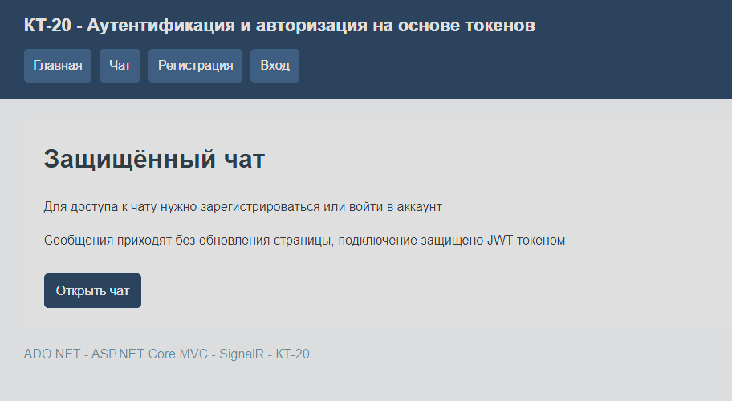

На главной странице есть ссылки на регистрацию, вход и чат

### Задание 2

Сделал регистрацию и вход с выдачей JWT
Пользователи хранятся в SQLite, пароли сохраняются в виде хешей
Добавил проверку полей и повторного имени

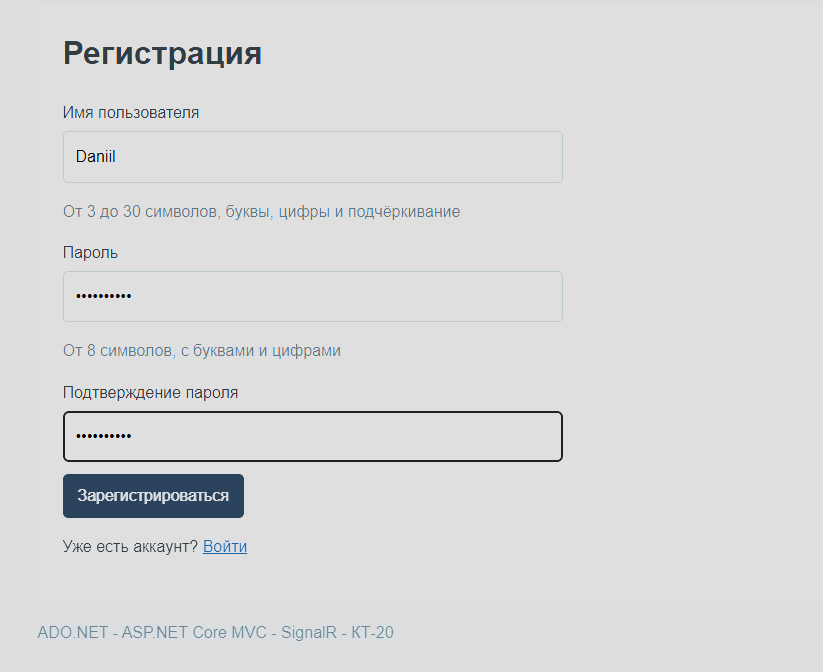

В форме заполнены имя, пароль и подтверждение пароля

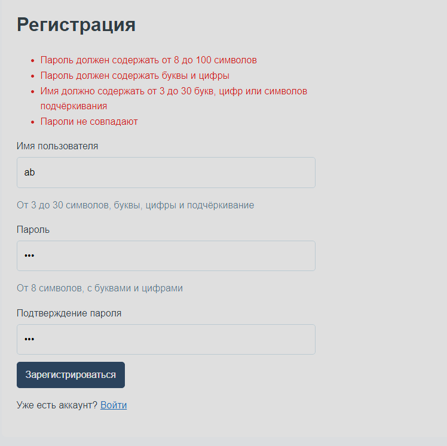

Неправильное имя, короткий пароль и несовпадение паролей вызывают ошибки

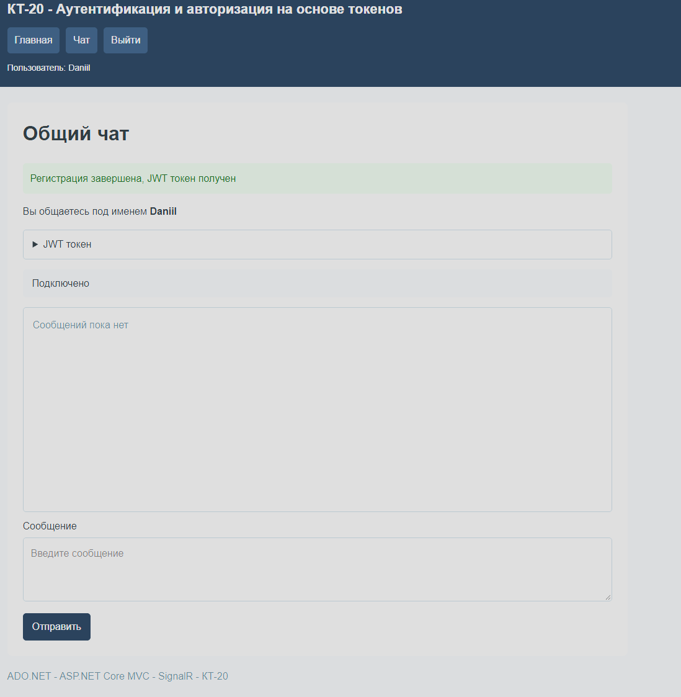

Пользователь Daniil зарегистрирован, получен токен и открыт чат

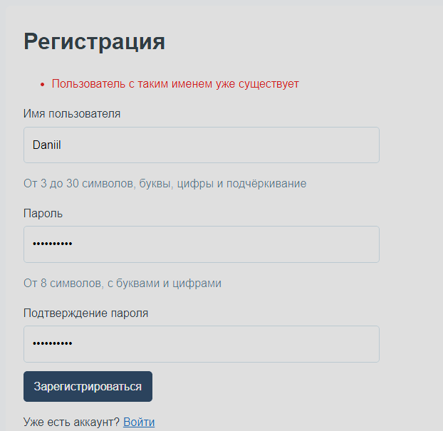

Повторная регистрация с тем же именем не проходит

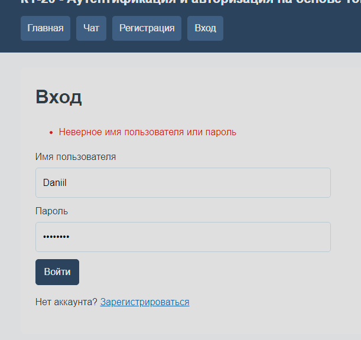

Неверный пароль вызывает ошибку входа

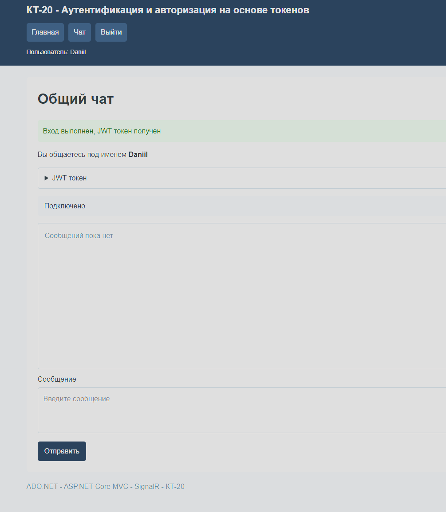

После правильного ввода данных получен новый токен и открыт чат

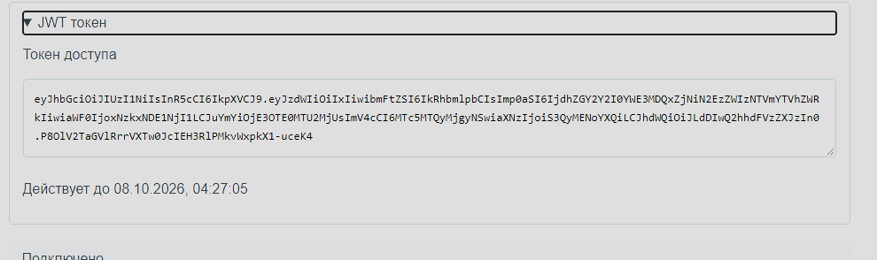

На странице показаны токен доступа и время окончания его действия

### Задание 3

Сделал общий чат на SignalR
Сообщения приходят без обновления страницы, имя отправителя берётся из JWT
Пустые сообщения не отправляются

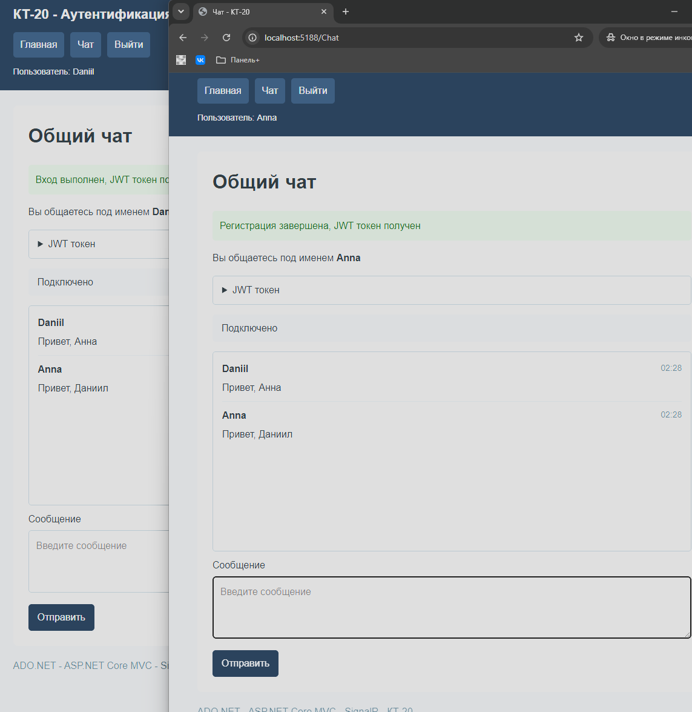

Daniil и Anna обмениваются сообщениями, переписка отображается в обоих окнах

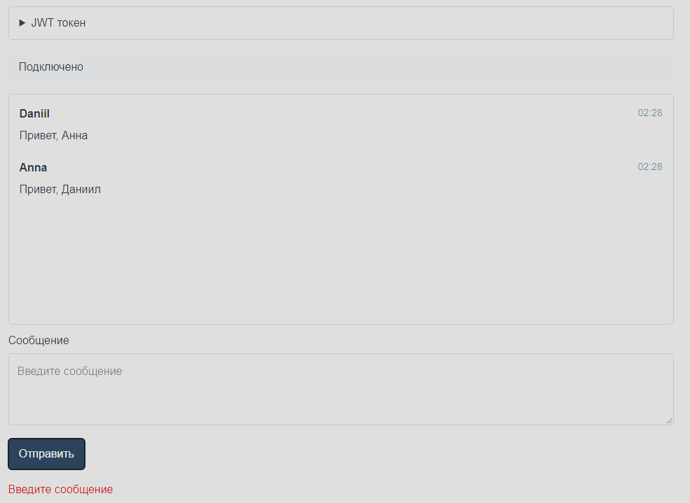

При попытке отправить пустое сообщение отображается ошибка

### Задание 4

Закрыл хаб для пользователей без действующего токена
При выходе токен удаляется из браузера, соединение закрывается
Без токена открывается форма входа

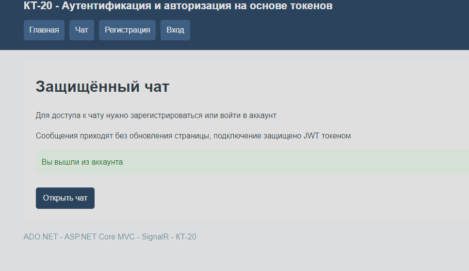

После выхода открыта главная страница, имя пользователя больше не отображается

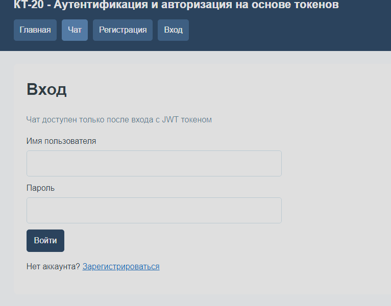

При открытии чата без токена отображается форма входа
